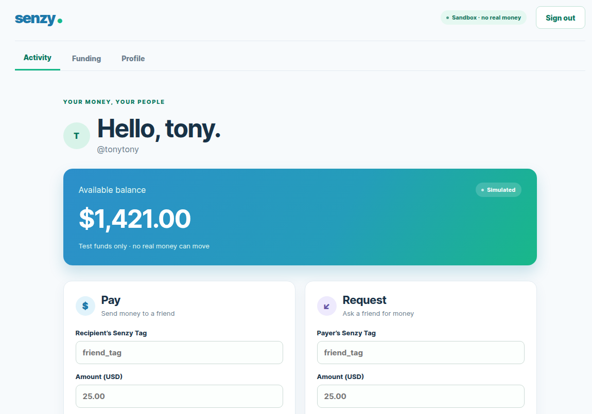

<div align="center">

# Senzy

### A calm, people-first foundation for peer-to-peer payments

Senzy is a web and mobile payments sandbox built to explore trustworthy payment flows, durable ledger behavior, and a polished social-payments experience.

<p>
  <a href="#quick-start">Quick start</a> ·
  <a href="#architecture">Architecture</a> ·
  <a href="#development">Development</a> ·
  <a href="#safety-boundary">Safety boundary</a>
</p>



</div>

> **Sandbox only.** Senzy does not move real money, connect to real banks, or accept real banking credentials. The balances, payments, funding sources, and reconciliation records are simulated development data.

## What is Senzy?

Senzy is a pragmatic starting point for building a modern peer-to-peer payments product. It combines a friendly social-payments interface with the backend foundations that payment workflows need:

- simulated payments, payment requests, funding, and wallet controls;
- integer minor-unit money values and explicit USD currency handling;
- double-entry ledger posting with immutable posted entries;
- scoped idempotency for safe retries;
- durable outbox delivery and notification history;
- sandbox banking and reconciliation workflows;
- cookie-authenticated web flows and bearer-token mobile flows;
- shared OpenAPI types, runtime validation, and API clients.

## Product surface

| Surface | Purpose |
| --- | --- |
| Web | React + TypeScript client for activity, Pay, Request, Funding, and Profile |
| Mobile | Expo / React Native client for the same authenticated sandbox workflows |
| API | ASP.NET Core modular monolith with Identity, payments, funding, ledger, notifications, and operations |
| Contracts | Generated OpenAPI types, Zod runtime schemas, and shared clients |
| Persistence | PostgreSQL system of record with reviewed EF Core migrations |

## Quick start

### Prerequisites

- Node.js `24.15.0` — use `nvm use` with the checked-in `.nvmrc`
- pnpm `11.1.3`
- .NET SDK `10`
- Docker Engine with Compose v2, or Docker Desktop
- Expo Go or an Android emulator for mobile development

### Run the API and web client

From the repository root:

```bash
nvm use
corepack enable
pnpm install --frozen-lockfile

docker compose -f infra/compose.yaml up -d postgres
pnpm db:migrate
pnpm dev:api
```

In a second terminal:

```bash
nvm use
pnpm dev:web
```

Open [http://localhost:5173](http://localhost:5173). The web client proxies `/api` to the development API at [http://localhost:4001](http://localhost:4001).

Useful development endpoints:

- API liveness: [http://localhost:4001/health](http://localhost:4001/health)
- API readiness: [http://localhost:4001/health/ready](http://localhost:4001/health/ready)
- OpenAPI: [http://localhost:4001/openapi/v1.json](http://localhost:4001/openapi/v1.json)

### Run the mobile client

With the API running, start Expo in another terminal:

```bash
pnpm dev:mobile
```

Scan the QR code with Expo Go, or launch an Android emulator.

## Docker Compose

Compose can run PostgreSQL, migrations, and the API together:

```bash
docker compose -f infra/compose.yaml build api migrate
docker compose -f infra/compose.yaml up -d --wait
docker compose -f infra/compose.yaml ps
```

The Compose setup publishes PostgreSQL on `localhost:5433` and the API on `localhost:4001`. The migration service completes before the API starts. After backend source changes, rebuild the API image; containers do not hot-reload.

To inspect service logs or stop the stack:

```bash
docker compose -f infra/compose.yaml logs -f api postgres
docker compose -f infra/compose.yaml down
```

The database files are stored in `/home/tony/data/senzy` by the local Compose configuration. Update `infra/compose.yaml` if you need a different host path.

## Architecture

Senzy is a layered modular monolith: one ASP.NET Core deployable, one PostgreSQL system of record, and feature modules that own their workflows.

```text
senzy/
├── apps/
│   ├── web/                 React + TypeScript web client
│   └── mobile/              Expo / React Native client
├── api-server/              ASP.NET Core API and feature routes
│   ├── Features/            HTTP boundaries and feature composition
│   ├── Modules/             Domain and application workflows
│   └── Infrastructure/      EF Core, providers, outbox, and persistence
├── packages/contracts/      OpenAPI artifacts, Zod schemas, and clients
├── tests/                   API, identity, ownership, ledger, and integration tests
├── infra/                   Docker Compose configuration
└── docs/                    Architecture, threat model, and operating guidance
```

Within a non-trivial backend module, dependencies point `API → Application → Domain`. Infrastructure implements persistence and provider boundaries at the composition root. Cross-module work uses explicit contracts rather than internal HTTP calls or ad hoc table writes.

## Development

Common commands from the repository root:

```bash
pnpm dev:web              # Start the web client
pnpm dev:api              # Start the ASP.NET API with hot reload
pnpm db:migrate           # Apply reviewed EF migrations
pnpm check                # TypeScript checks plus API build
pnpm contracts:check      # Validate generated contracts and runtime samples
pnpm test                 # Workspace and .NET tests
pnpm build:web            # Production web build
pnpm lint:mobile          # Mobile linting
pnpm build:mobile         # Expo export
```

When changing an API surface, run `pnpm contracts:generate`, inspect the generated OpenAPI and TypeScript diff, update runtime schemas and consumers, then run `pnpm contracts:check`.

Persistence tests require an isolated PostgreSQL connection in `SENZY_TEST_POSTGRES`. For the bundled local database:

```bash
export SENZY_TEST_POSTGRES='Host=localhost;Port=5433;Database=senzy;Username=senzy;Password=senzy'
pnpm test
```

Never point this variable at production data.

## Safety boundary

Senzy is not approved for real-money use or public deployment. In particular:

- banking is a development-only in-memory stub;
- raw routing and account fields are rejected;
- simulated records must not be described as settled funds;
- PostgreSQL remains authoritative for balances, ledger state, idempotency, and outbox records;
- external provider work is modeled as explicit pending workflows, not atomic with PostgreSQL;
- migrations are applied explicitly rather than independently by every API replica.

Read the [threat model](docs/THREAT_MODEL.md) before changing authentication, authorization, provider boundaries, logging, or public exposure.

## Documentation

- [Backend architecture](docs/BACKEND_ARCHITECTURE.md)
- [Web client guide](apps/web/README.md)
- [API guide](api-server/README.md)
- [Contracts guide](packages/contracts/README.md)
- [Operating targets](docs/OPERATING_TARGETS.md)
- [Threat model](docs/THREAT_MODEL.md)
- [Product plan](docs/PRODUCT_PLAN.md)

## License

This repository is an internal development foundation. Licensing and contribution terms should be finalized before public distribution.
