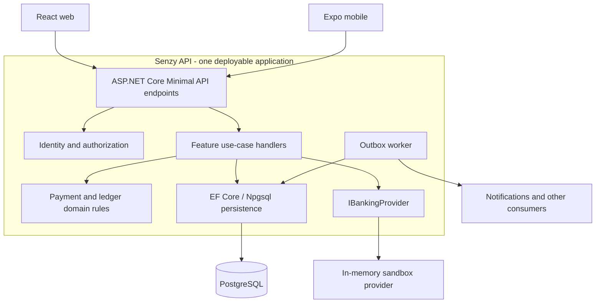

# Senzy API architecture

## Architecture decision

Build Senzy as a **pragmatic layered modular monolith using ASP.NET Core Minimal APIs**, organized first by business feature. Web and mobile call the same versioned HTTP API. The backend is one deployable application, with PostgreSQL as its system of record.

Minimal APIs define the HTTP boundary; they do not replace application and domain boundaries. Keep endpoint handlers small and put payment rules and transaction coordination in independently testable classes.

Server-rendered MVC views are unnecessary because React and Expo provide the user interfaces. Controller-based APIs remain a valid alternative if future requirements justify them, but adopting controllers is not required to organize the application. See [Microsoft's API overview](https://learn.microsoft.com/en-us/aspnet/core/fundamentals/apis?view=aspnetcore-10.0).

This document records the concrete backend architecture and the blueprint for upcoming payment work. Delivery phases and launch gates remain in the [product plan](../docs/PRODUCT_PLAN.md), and decision rationale lives in the [architecture decisions](../docs/ARCHITECTURE_DECISIONS.md).

## System architecture



Identity, EF Core persistence, simulated payment use cases, the ledger, atomic outbox records, Npgsql connectivity, and the banking stub exist today. Outbox delivery and reconciliation are Phase 3 work. Web and mobile both call the authenticated API through the shared contract client. All application modules execute in the same process. No Redis or Kafka deployment is required for the initial implementation.

## Current implementation — implemented

The API currently contains feature modules for health, configuration, Identity, profiles, simulated payments, the ledger, fixture activity, client telemetry, and sandbox banking. `SenzyDbContext` persists Identity, profiles, wallets, payments, requests, ledger records, scoped idempotency outcomes, and outbox records through reviewed EF Core migrations. Cross-cutting middleware supplies correlation IDs, structured request logs, consistent Problem Details, CORS, cookie antiforgery/origin checks, session-stamp validation, authorization, and rate limits. Data Protection keys persist through the Compose `api-keys` volume.

HTTP, domain, and PostgreSQL integration tests live in `tests/Senzy.Api.Tests`; OpenAPI export tooling lives in `tools/Senzy.ContractExport`. Payment processing and ledger posting are implemented for simulated internal USD transfers. Durable outbox delivery, reconciliation, simulated funding, and real banking are not implemented.

See the [architecture decisions](../docs/ARCHITECTURE_DECISIONS.md) for authentication, persistence, payment states, and contract decisions.

| Method and route | Owner | Availability and behavior |
| --- | --- | --- |
| `GET /health` | Health | All environments; process liveness, service name, and UTC timestamp. |
| `GET /health/ready` | Health | All environments; runs `SELECT 1`, returns 200 or 503 Problem Details. |
| `GET /openapi/v1.json` | OpenAPI | Development only; contract document. |
| `GET /v1/config` | Configuration | Public client feature flags. |
| `GET /v1/auth/csrf` | Identity | Issues the antiforgery request token used by cookie clients. |
| `POST /v1/auth/register` | Identity | Creates an Identity user and profile atomically. |
| `POST /v1/auth/login` | Identity | Cookie mode for web or opaque bearer/refresh tokens for mobile. |
| `POST /v1/auth/refresh` | Identity | Validates and rotates a mobile bearer session. |
| `POST /v1/auth/logout` | Identity | Authenticated; rotates the security stamp and signs out cookies. |
| `GET /v1/profile` | Profiles | Authenticated private profile. |
| `PUT /v1/profile` | Profiles | Authenticated display-name/handle update. |
| `GET /v1/activity` | Activity | Authenticated, private fixture data; never ledger data. |
| `GET /v1/wallet/` | Ledger/Payments | Authenticated simulated USD available and settled balance. |
| `GET /v1/payments/` | Payments | Authenticated private sent/received payment history. |
| `POST /v1/payments/` | Payments | Authenticated idempotent simulated send with atomic ledger/outbox posting. |
| `POST /v1/payments/{id}/reverse` | Payments | Sender-only idempotent full compensating reversal. |
| `GET /v1/payment-requests/` | Payments | Authenticated private incoming/outgoing request history. |
| `POST /v1/payment-requests/` | Payments | Authenticated idempotent request creation. |
| `POST /v1/payment-requests/{id}/accept` | Payments | Payer-only idempotent request acceptance and posting. |
| `POST /v1/telemetry` | Telemetry | Authenticated allowlisted analytics/error event. |
| `GET /v1/banking/institutions` | Banking | Development only; sandbox institution list. |
| `POST /v1/banking/link-sessions` | Banking | Development and authenticated; creates an actor-bound, 15-minute link token. |
| `POST /v1/banking/accounts` | Banking | Development and authenticated; consumes the actor's token once. |
| `GET /v1/banking/accounts` | Banking | Development and authenticated; reads only the actor's simulated accounts. |

The stub's sessions and accounts are in memory and reset on API restart; the database bind mount does not persist them. Ownership is always derived from the authenticated principal, never from a caller-supplied user ID.

## Code organization

Paths below are relative to the repository root:

```text
api-server/
  Program.cs
  Features/
    Health/
      HealthRoutes.cs
    Identity/
      IdentityRoutes.cs
      ApplicationUser.cs
      SessionValidator.cs
    Profiles/
      Profile.cs
      ProfileRoutes.cs
    Banking/
      BankingEndpoints.cs
      IBankingProvider.cs
    Payments/
      Application/
        PaymentContracts.cs
        PaymentService.cs
      Domain/
        PaymentModels.cs
      PaymentRoutes.cs
    Ledger/
      Application/
        SandboxWalletService.cs
      Domain/
        LedgerModels.cs
        LedgerPostingService.cs
    Activity/
      ActivityRoutes.cs
    Configuration/
      ConfigurationRoutes.cs
    Telemetry/
      TelemetryRoutes.cs
  Infrastructure/
    Persistence/
      SenzyDbContext.cs
      OperationalModels.cs
      Migrations/
    Banking/
      StubBankingProvider.cs
  Common/
    ApiErrors.cs
tests/
  Senzy.Api.Tests/                # HTTP, domain, and PostgreSQL integration tests
tools/
  Senzy.ContractExport/           # Existing in-memory OpenAPI exporter
```

Group code by business capability, then by use case where useful. Small features can start with an endpoint file and a service; they do not need every folder shown above. Use feature-specific namespaces for repeated filenames such as `Handler.cs`.

Start with one application project and separate test projects. Extract class libraries when compile-time boundaries or independent reuse provide a concrete benefit. `Common/` is reserved for genuinely shared concerns, not miscellaneous business logic.

The existing `Banking/` directory stays in place until its next feature change. At that point, move its HTTP contract and provider interface to `Features/Banking/` and the stub implementation to `Infrastructure/Banking/`. Avoid maintaining both old and new implementations.

## Pragmatic layer boundaries

Feature modules are the ownership boundary. Layers describe dependency direction inside those modules:

| Layer | Responsibility | May depend on |
| --- | --- | --- |
| API | HTTP binding, transport validation, authentication/authorization policies, response mapping. | Application contracts and shared API concerns. |
| Application | Use-case orchestration, actor ownership, transaction boundaries, idempotency, calls to domain behavior and required ports. | Domain and narrow infrastructure abstractions. |
| Domain | Entities, value objects, state transitions, and financial invariants. | The .NET base library and its own module only. |
| Infrastructure | EF Core mappings, PostgreSQL access, migrations, banking/provider adapters, and outbox delivery. | Application ports, domain types, and framework/provider libraries. |

Dependency flow points inward: API → Application → Domain. Infrastructure plugs into application-defined boundaries through dependency injection. Domain code must not reference HTTP request types, EF entities/configuration, `HttpContext`, or provider SDKs.

Apply these layers when they earn their keep. A small configuration query or profile update can remain a route plus a focused operation. Payment posting requires separate endpoint, application handler, domain rules, and persistence implementation because it has transactions, concurrency, idempotency, and invariants. Refactor toward another layer when behavior appears; do not pre-create empty folders or pass-through classes.

Module boundaries remain firm even though the process and database are shared:

- A module owns its writes and invariants.
- Cross-module work uses explicit methods/contracts, not another module's endpoint DTOs or ad hoc table mutations.
- Read projections may join data with authorization and pagination, but cannot become an alternate write path.
- `SenzyDbContext` provides atomicity; it does not make every entity shared.
- Start in one project. Extract class libraries only for useful compile-time enforcement or reuse.

## Module ownership

| Module | Owns | Allowed collaboration |
| --- | --- | --- |
| Identity | Credentials, sessions, confirmation, recovery, authenticated actor. | Profiles references its user ID; other modules consume the authenticated actor, not password records. |
| Profiles | Display names, normalized unique payment handles, profile preferences. | Resolves a recipient to a user ID for Payments. |
| Payments | Send/reversal use cases, payment lifecycle, command idempotency. | Invokes Ledger within the posting transaction; uses provider abstractions for future funding workflows. |
| Ledger | Accounts, immutable transactions and entries, balance invariants. | Returns posting results to Payments; never calls payment HTTP endpoints or providers. |
| Banking | Funding-source selection and provider-facing application operations. | Uses `IBankingProvider`; cannot directly change wallet balances. |
| Activity | Private read models for the current user's history. | Queries authorized projections; cannot post or edit ledger entries. |
| Outbox infrastructure | Delivery claims, retry schedule, delivery status. | Reads committed messages; invokes idempotent handlers after the business transaction commits. |

Keep module-owned writes inside their use cases. A shared DbContext is a transaction mechanism, not permission for every feature to mutate every table. Read-only projections may join across modules when needed, with explicit ownership checks and pagination.

## Responsibilities and dependencies

| Component | Responsibility |
| --- | --- |
| `Program.cs` | Compose dependencies, middleware, and endpoint registration. |
| Endpoints | Bind and validate request shape, require authorization, invoke a use case, and translate results into HTTP responses. |
| Use-case handlers | Enforce ownership and application policies, coordinate domain operations, and own the transaction and idempotency workflow. |
| Domain types and services | Enforce payment transitions, valid monetary amounts, balanced postings, and reversal rules. |
| Infrastructure | Implement persistence, banking adapters, and durable event delivery. |

Endpoints call use cases; use cases invoke domain behavior and persistence or provider dependencies. For small features, the use case may initially be a focused endpoint-local operation. Once business branching, transactions, reuse, or independent tests appear, extract an application handler rather than growing the endpoint. Domain rules must not depend on HTTP request types, endpoint implementations, EF Core, or external banking SDKs.

Use a scoped `SenzyDbContext` and scoped use-case handlers for database work. Register stateless domain services according to their dependencies. Retain the current singleton `NpgsqlDataSource` connection pool and development stub where appropriate. The future singleton hosted outbox worker must create a service scope for each batch rather than capture a scoped DbContext.

Derive the acting user's identity from the authenticated principal. A client-supplied user identifier must never establish ownership or authority. Resource-specific authorization belongs in the use case as well as any endpoint-level access policy.

Use ordinary dependency-injected classes initially. Add interfaces at meaningful boundaries, such as banking providers or persistence operations that need substitution. Do not introduce MediatR, generic repositories, or an interface for every class by default.

Keep API request and response types separate from persistence entities. OpenAPI is the authoritative HTTP contract; `pnpm contracts:generate` exports it and generates shared TypeScript types. CI checks for drift and validates representative live responses against the shared Zod schemas. Errors use Problem Details with a stable `code` and correlation/trace ID without exposing internal exception details.

## Request processing and authentication — implemented

An authenticated request follows this sequence:

1. Establish a request/trace identifier and a consistent exception boundary.
2. Apply the configured origin policy, authenticate the cookie or bearer token, and enforce endpoint authorization and rate limits.
3. For cookie-authenticated mutations, validate antiforgery protection. Bind and validate the request DTO.
4. Invoke a feature handler with the authenticated actor and cancellation token. The handler checks resource ownership and business policy.
5. Execute domain rules and persistence operations. For commands, complete the required transaction before reporting success.
6. Translate the outcome to a typed API response or Problem Details. Record outcome and latency without credentials or unrestricted request bodies.

Phase 1 uses ASP.NET Core Identity with PostgreSQL storage. Browser clients use HTTP-only, same-site cookies with antiforgery protection; mobile uses Identity's first-party opaque bearer tokens and Expo SecureStore for its refresh token on native platforms. These tokens are not third-party OAuth/JWT credentials. The Compose deployment persists the Data Protection key ring. Every authenticated request validates the security stamp, and logout rotates it so existing cookie and bearer sessions are revoked.

Use 400 for invalid input, 401 for missing/invalid authentication, 403 for denied operations, 404 for missing or deliberately concealed resources, and 409 for command/state conflicts. Define a stable application error code alongside Problem Details so clients do not parse human-readable messages. Endpoint policies and handlers must agree on whether unauthorized resource existence is concealed.

## Persistence model

Use one `SenzyDbContext`, based on the Identity EF Core context, with PostgreSQL through the Npgsql EF provider. Keep reviewed migrations in `Infrastructure/Persistence/Migrations/` and add separate entity-configuration classes as the model grows. The records below are implemented by the initial and Phase 2 migrations.

| Record | Key relationships and constraints |
| --- | --- |
| Identity user | Stable user ID; credentials and recovery state managed by Identity. |
| Profile | One per user; normalized payment handle has a unique database constraint. |
| Payment | Sender, recipient, integer amount, currency, state, timestamps, and optional original-payment link for reversal. |
| Ledger account | Currency and account purpose; user-owned accounts reference a user, system accounts have an explicit system owner. Unique owner/purpose/currency combination. |
| Ledger transaction | Links a posting to a payment; reversal references the original transaction; a uniqueness constraint prevents duplicate posting for the same payment operation. |
| Ledger entry | Transaction ID, account ID, debit/credit side, and positive integer minor-unit amount. Entries within a transaction balance per currency. |
| Idempotency record | Unique actor/operation/key, canonical request fingerprint, committed outcome, and related payment ID. |
| Outbox message | Stable event ID, event type and payload version, aggregate ID, payload, creation time, retry/claim state, and delivery status. |

Use `long` amounts in .NET/PostgreSQL-compatible integer storage and keep exposed JSON values within JavaScript's safe integer range. Start with USD and no FX. Available balance and settled balance have separate meanings; future holds need their own explicit model.

Database constraints enforce uniqueness, references, and valid row values. A row-level check alone cannot enforce the aggregate balance of a multi-entry transaction: `LedgerPostingService` constructs equal debit and credit entries and validates the aggregate before commit. Ledger entries remain the financial record; the maintained balance is a transactionally updated projection that must reconcile to them. Restricting the deployment database role from bypassing the controlled posting path remains a pre-pilot hardening task.

Run migrations as an explicit deployment step, not independently from every API replica. SQL used for locking must share the DbContext's connection and active transaction.

## Payments and ledger boundaries

Payments owns payment commands and legal state transitions. Ledger owns balanced accounting entries and posting invariants. These are logical modules in the same application, sharing the transaction required for a payment posting.

A payment use case owns one PostgreSQL transaction that commits all of the following together:

1. The payment state.
2. The scoped idempotency result.
3. The balanced ledger entries.
4. The outbox event.

Ledger and persistence operations participate in that transaction; they must not independently commit pieces of the payment. Return a posted result only after the commit succeeds.

Required invariants:

- Store amounts as integer minor units with explicit currency; never use floating-point money.
- Enforce balanced postings and make posted ledger entries immutable.
- Correct posted transactions through linked reversals.
- Persist scoped idempotency keys and return the original outcome for a valid replay; reject reuse with a different command payload.
- Use database concurrency controls to prevent overspending and conflicting updates.
- Keep available balance policy distinct from settled ledger balance.

External provider calls must not be treated as atomic with PostgreSQL. Future external workflows need explicit pending states, durable work, retries, and reconciliation. Clients never write directly to the ledger or banking provider.

### Concrete send-payment flow — implemented in Phase 2

`Features/Payments/Application/PaymentService.cs` coordinates the following operation. PostgreSQL concurrency, retry, and rollback tests validate the locking strategy.

1. Authenticate the sender, validate amount/currency, resolve the recipient, and compute the canonical request fingerprint.
2. Begin the PostgreSQL transaction and claim the unique actor/operation/idempotency key. A duplicate waits for the competing transaction's outcome, then replays a matching committed result or rejects a changed fingerprint. Do not continue an aborted PostgreSQL transaction after a uniqueness error; use conflict-safe insertion or restart the transaction.
3. Lock affected ledger-account rows in deterministic account-ID order. Every posting path, including reversal and simulated funding, must obey the same locking protocol. Check available funds under those locks.
4. Create the payment and ask `LedgerPostingService` to construct and validate the balanced entries. The ledger service adds changes to the caller's unit of work and never commits independently.
5. Persist the posted state, ledger changes, idempotency outcome, and outbox message. Commit once.
6. Return the committed result. If the connection drops around commit, the client retries with the same key to discover the durable outcome.

Insufficient funds or invalid state must not leave partial postings. Define which business rejections are persisted as idempotent outcomes before implementation. Deadlock/serialization retries are bounded and repeat the whole transaction, not only its final write. No provider HTTP call occurs while account locks are held.

### Payment state machine — implemented for internal transfers and reversals

| Transition | Condition |
| --- | --- |
| New command → `posted` | Immediate internal transfer commits successfully. |
| New command → `pending` | A durable external workflow is required; this does not imply a settled posting. |
| `pending` → `posted` | Settlement and required ledger posting commit. |
| `pending` → `failed` | Workflow terminates without settlement and releases any holds. |
| `posted` → `reversed` | A linked full compensating transaction commits. |

`failed` and `reversed` are terminal. Validation/authentication failures do not create payments. An uncertain commit is not automatically a failed payment. Payment requests are invitations to pay with their own lifecycle; accepting one invokes the payment use case. Partial reversals and holds require an additional design before implementation.

## Events and scaling

Write outbox records with the payment transaction and publish them after commit. Start with a durable worker and idempotent consumers. Notifications and analytics run outside the payment commit.

The worker claims a bounded batch using database coordination and an expiring lease, delivers outside the claim transaction, then records the outcome. A crash after delivery but before acknowledgement can deliver an event twice, so consumers deduplicate by event ID. Retry transient failures with backoff, retain failed messages for inspection/replay, and monitor oldest-message age. Do not promise exactly-once delivery. A future broker replaces the delivery destination without changing payment commit ownership.

Add Redis for measured caching or rate-limit needs, and Kafka when throughput or consumer separation warrants it. Neither is authoritative for balances, payment state, or idempotency. Keep API instances stateless; the current in-memory banking stub is development-only and is not a production persistence design.

## Testing approach

- Unit-test domain invariants and payment state transitions without an HTTP server.
- Test HTTP contracts, authorization, validation, errors, health, and sandbox routes through an ASP.NET Core test host.
- Test migrations, posting, idempotency, rollback, and concurrent spending against actual PostgreSQL.
- Add failure-injection tests around commit and retry boundaries, and verify balanced entries and absence of duplicate postings.
- Add contract checks so changes to the API cannot silently drift from the web and mobile clients.

The root `pnpm test` command runs available TypeScript workspace tests and the .NET integration suite. CI supplies PostgreSQL. Locally, set `SENZY_TEST_POSTGRES` to enable PostgreSQL tests; each test host creates and drops an isolated schema. The current suite covers migrations, authentication, CSRF/origin enforcement, bearer refresh/revocation, profile persistence and uniqueness, ownership, lockout, telemetry, feature flags, health, banking sandbox ownership, ledger invariants, state transitions, payment/request ownership, idempotency, concurrent overspending, reversal, and transaction rollback through failure injection.

## Runtime and deployment — implemented

| Component | Local address | Container address / persistence |
| --- | --- | --- |
| API | `http://127.0.0.1:4001` | Compose service `api`, HTTP port 8080, non-root .NET 10 runtime. |
| PostgreSQL | `127.0.0.1:5433` | Compose service `postgres`, port 5432, PostgreSQL 17. |
| Database files | `/home/tony/data/senzy` | Bind-mounted at `/var/lib/postgresql/data`. |
| Data Protection keys | n/a | Named Compose volume `api-keys` at `/home/app/.aspnet/DataProtection-Keys`. |

The multi-stage [Dockerfile](Dockerfile) restores/builds with the SDK image and publishes into the ASP.NET runtime image. The root `.dockerignore` restricts the build context to backend inputs and excludes local settings and build output. [Compose](../infra/compose.yaml) starts the API after PostgreSQL becomes healthy, overrides `ConnectionStrings__Postgres` to use `Host=postgres;Port=5432`, and probes `/health/ready` for API health. Host-side development uses `localhost:5433` from `appsettings.Development.json`.

Compose currently runs in Development and publishes only to loopback, making sandbox endpoints and OpenAPI available locally. Rebuild after source changes; containers do not hot-reload. Stopping or recreating containers preserves the bind-mounted PostgreSQL files and Data Protection key volume but clears the in-memory banking stub. Run migrations explicitly before starting a release; API replicas do not migrate themselves.

## Implementation sequence

1. Phase 0 implemented: health module, contract export/generation, baseline tests, CI configuration, and local container deployment. The first hosted CI run is tracked separately in the [verification record](../docs/PHASE_0.md).
2. Phase 1 implemented: `SenzyDbContext`, the initial migration, Identity, cookie/bearer sessions, ownership policies, consistent errors, tracing, profiles, private fixture activity, feature flags, telemetry, and authenticated sandbox ownership.
3. Phase 2 implemented: payment/request state machines, send/accept/reversal use cases, ledger posting, durable idempotency, atomic outbox writes, web/mobile experiences, and PostgreSQL concurrency/retry/failure tests.
4. Phase 3 next: add simulated funding, reconciliation, outbox delivery, and operations views.
5. Phase 4 and later: validate the [operating targets](../docs/OPERATING_TARGETS.md), add measured scaling components, and complete launch gates from the product plan.

## Local development

To run both PostgreSQL and the API in containers, build the API, start PostgreSQL, and apply migrations with `docker compose -f infra/compose.yaml build api`, `docker compose -f infra/compose.yaml up -d --wait postgres`, and `docker compose -f infra/compose.yaml run --rm --no-deps api --migrate`; then use `docker compose -f infra/compose.yaml up -d --wait`. See the [Docker Compose instructions](../README.md#database-and-api-with-docker-compose) for persistence, ports, and switching to host-side hot reload.

From the repository root:

```sh
dotnet watch run --project api-server/Senzy.Api.csproj --launch-profile http
dotnet build api-server/Senzy.Api.csproj
pnpm db:migrate
```

The development API runs on port `4001`. `/health` reports liveness; `/health/ready` requires PostgreSQL. Development OpenAPI is available at `/openapi/v1.json`.

See the [repository README](../README.md) for frontend prerequisites, PostgreSQL setup, and sandbox endpoint details.
