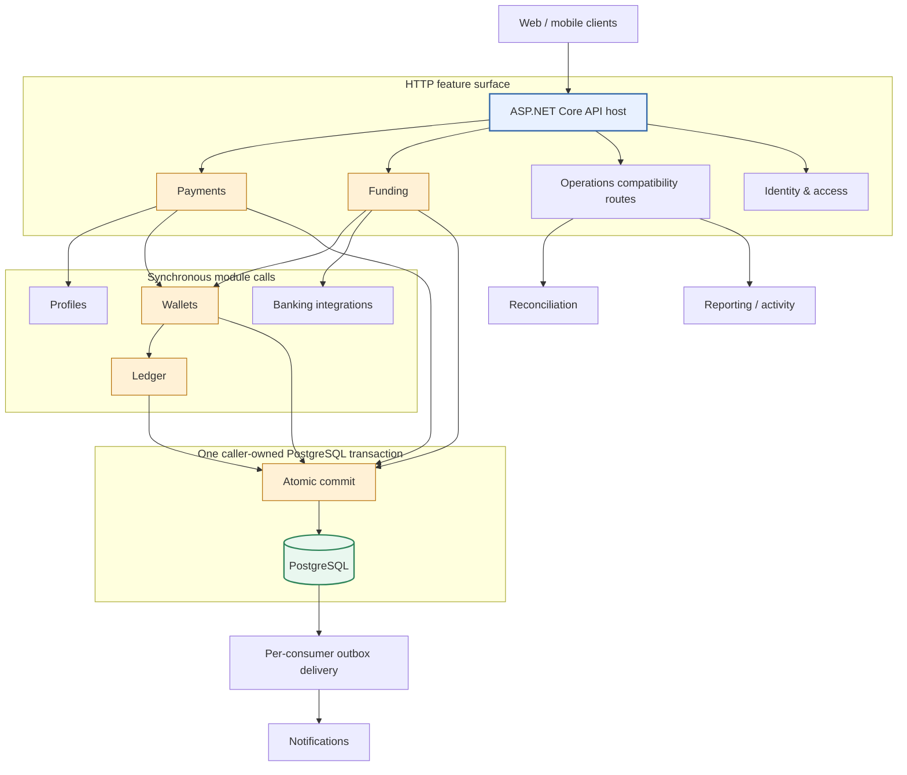

# Senzy backend architecture

Status: authoritative architecture and refactor plan, accepted 2026-10-23. The document describes the current simulated-money implementation and the approved target state. Sections labelled planned are not evidence that the work is complete. This design does not authorize real-money operation or public deployment.

## Scope and constraints

Senzy remains a modular monolith:

- one ASP.NET Core application artifact and one PostgreSQL system of record;
- Minimal APIs for the HTTP boundary;
- synchronous in-process calls between modules;
- stable `/v1` HTTP contracts for web and mobile;
- shared persistence during the first refactor waves;
- explicit deployment migrations, not per-replica startup migration;
- no internal HTTP, mandatory broker, distributed transaction, MediatR, generic repository, or generic unit-of-work layer.

The refactor prepares selected modules for future independent scaling or extraction. It does not turn every feature into a contract or class library. Contracts are required at scale-critical, provider, consumer, or financial-invariant boundaries. Profiles, Identity, Reconciliation, Reporting, and small CRUD features remain concrete until measurement or an extraction requirement justifies a boundary.

The current implementation is simulated money only. Banking is a Development-only in-memory stub; durable provider-transfer rows are reconciliation fixtures, not bank settlement evidence.

## System shape



The current application runs all modules and hosted workers in one process. PostgreSQL is authoritative for identities, payments, funding, balances, ledger entries, idempotency, outbox events, notifications, wallet controls, and reconciliation runs.

## Module ownership

| Module | Owns | Boundary policy |
| --- | --- | --- |
| Identity & Access | Credentials, sessions, revocation, access policies | Keep concrete around ASP.NET Identity; other modules consume the authenticated actor. |
| Profiles | Display names, handles, recipient discoverability | Concrete operation for now; promote only if recipient resolution becomes independently scaled. |
| Payments | Payments, requests, lifecycle, reversals, payment idempotency | Must use Wallets movement and Ledger posting contracts. |
| Wallets | Wallet controls, freezes, limits, wallet movement coordination | `IWalletPolicy` and `IWalletMovementService`; owns locking and policy checks in the caller transaction. |
| Ledger | Accounts, journal transactions, entries, balance projections | `ILedgerPostingService`; only Ledger creates accounting postings and updates balances. |
| Funding | Cash-in/out workflows, transfer records, funding idempotency | Uses Wallets and the Banking provider boundary. |
| Banking | Linked sources and provider adapters | `IBankingProvider`; provider calls are never treated as atomic with PostgreSQL. |
| Notifications | Notification records and event handlers | Consumer-specific handler and deduplication; delivery mechanics stay in infrastructure. |
| Reconciliation | Consistency checks, discrepancies, resolution history | Concrete worker/service until separate worker scaling is justified. Never edits posted entries. |
| Reporting / Activity | User-facing read projections and combined history | Concrete read services; disclose freshness where projections are used. |
| Host / infrastructure | Composition, middleware, persistence wiring, outbox mechanics, telemetry | No business ownership or catch-all contracts. |

Operations routes remain as a compatibility surface. Freeze/status are implemented by Wallets, reconciliation by Reconciliation, and combined history by Reporting.

## Layer and dependency rules

Inside a non-trivial scale-critical module, dependencies point inward:

```text
API → Application → Domain
Infrastructure → Application / Domain
Host → module registration and public application contracts
```

Endpoints bind and validate HTTP, authorize, invoke a use case, and map responses. Application workflows own actor/resource ownership, idempotency, transaction boundaries, and orchestration. Domain code owns state transitions and financial invariants without ASP.NET Core, EF Core, HTTP DTOs, or provider SDKs. Infrastructure implements persistence and provider concerns.

Do not expose `DbSet`, `IQueryable`, tracked entities, persistence models, HTTP DTOs, or provider SDK types through selected contracts. Read-only joins are explicit and authorized. A shared `SenzyDbContext` provides transaction coordination; it does not grant write permission to every module.

## Selected contracts

The current contract boundary is intentionally narrow:

- `IWalletPolicy`: freeze state, daily usage, outbound authorization, and controls;
- `IWalletMovementService`: movement command/result, deterministic wallet locking, and policy-controlled movement coordination;
- `ILedgerPostingService`: posting command/result and ledger invariant enforcement;
- `IBankingProvider`: sandbox/provider adapter boundary;
- per-consumer outbox handlers and delivery state.

Wallet movement contracts use Wallets/Ledger concepts rather than EF persistence enums. Payments and Funding remain transaction owners. Profiles, Reconciliation, Reporting, and Identity use concrete services until scale evidence changes that decision.

## Financial transaction protocol

Payments and Funding execute one PostgreSQL transaction:

1. Validate input and compute the canonical request fingerprint.
2. Claim the actor/operation/idempotency key and replay a matching committed result.
3. Resolve participants and invoke Wallets.
4. Wallets locks affected accounts in deterministic order and evaluates freeze, limit, and balance policy under the lock.
5. Wallets invokes Ledger to construct balanced entries and update the balance projection.
6. The initiating module persists its business state, idempotency outcome, and outbox event.
7. Commit once; acknowledge success only after commit.

Posted entries are immutable. Corrections use linked compensating transactions. An uncertain commit remains unknown until a retry or query establishes the durable idempotency result. External provider calls never occur while financial locks are held and cannot join the PostgreSQL transaction.

## Outbox and asynchronous work

Outbox events are immutable and include an event ID, type, payload version, aggregate ID, optional correlation/causation IDs, payload, and creation time. Delivery state is stored per consumer with leases, attempts, retry time, error, and delivered time.

Delivery is at least once, never exactly once. Consumers deduplicate by event ID or their own unique source constraint. Failed deliveries remain inspectable and require authorized replay. Notifications owns notification handling; infrastructure owns claiming, leases, retries, and worker scopes. A broker is optional and requires measured need.

Reconciliation uses a defined consistency cutoff or snapshot, records discrepancies, and routes corrections through authorized financial workflows. Reporting projections must be rebuildable without reposting money or duplicating notifications.

## Authentication, privacy, and safety

Derive the actor from the authenticated principal. Web mutations use secure cookies, origin checks, and antiforgery; mobile uses opaque bearer tokens and protected refresh storage. Preserve security-stamp validation and protected Data Protection keys across replicas.

Use Problem Details with stable application error codes and correlation IDs. Never log tokens, passwords, raw bank details, unrestricted request bodies, or unnecessary private data. Keep user IDs out of metric labels. Do not describe simulated provider records as settled funds.

## Refactor sequence

Each step must leave the API runnable and preserve `/v1` behavior.

1. **Baseline and architecture checks** — characterize current routes, lock order, idempotency, ownership, and selected dependency rules.
2. **Financial boundaries** — keep Payments/Funding as transaction owners; enforce Wallets and Ledger contracts; test atomicity, rollback, freeze races, and concurrent spending.
3. **Per-consumer outbox** — migrate delivery rows, move notification handling to Notifications, and test leases, retries, deduplication, failed delivery, and replay.
4. **Logical module ownership** — keep Operations as a compatibility surface while Reconciliation and Reporting own their workflows; remove alternate cross-module write paths.
5. **Assembly enforcement** — after behavior is behind stable contracts, extract useful class libraries into the same deployable application and add dependency-cycle checks.
6. **Replica and worker hardening** — coordinate scheduled reconciliation, configure worker roles, share protected keys, define global rate-limit strategy, manage pools, and validate multi-instance recovery.

## Verification and acceptance

Run `dotnet build api-server/Senzy.Api.csproj`, `pnpm check`, `pnpm contracts:check`, and `pnpm test` with `SENZY_TEST_POSTGRES` configured for persistence tests. Review every EF migration and verify `/health/ready` after runtime changes.

Required PostgreSQL scenarios include duplicate and conflicting idempotency, concurrent sends/funding, freeze-versus-spend races, rollback before commit, uncertain commit recovery, balanced ledger projections, and one transaction across business state, Wallets, Ledger, idempotency, and outbox.

Required multi-instance scenarios include session revocation, shared keys, idempotency, worker crash/lease takeover, duplicate delivery, scheduled-run uniqueness, database restart, backup restore, and post-restore reconciliation. Measured results are recorded separately from aspirational operating targets.

## Current implementation status

Implemented: Wallets movement/policy boundary, Ledger posting contract, per-consumer outbox schema and migration, Notifications handler extraction, Reporting and Reconciliation logical ownership, and architecture dependency tests.

Not yet complete: class-library extraction, coordinated worker roles, global rate limiting, durable multi-instance sandbox state, full architecture dependency enforcement, and multi-instance/recovery validation.
