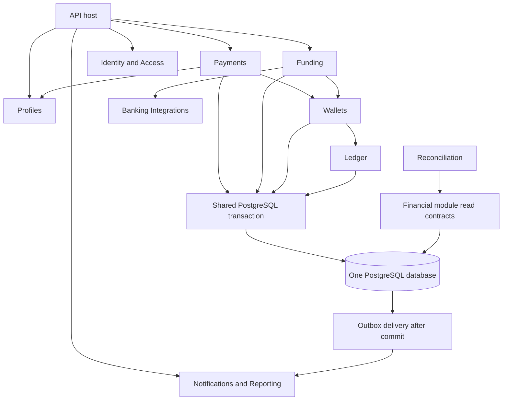

# Modular monolith refactor guide

Status: accepted target, 2026-10-23; first implementation wave landed in commits `644aef5` and the current working change. The remaining milestones are not complete. This guide implements the direction in [ADRs 007–010](ARCHITECTURE_DECISIONS.md#adr-007--enforceable-module-ownership-within-one-application). It is an engineering migration sequence, not a replacement for product delivery gates or evidence of completed verification.

## Scope and constraints

Retain one application artifact, one PostgreSQL database, ASP.NET Core Minimal APIs, and direct in-process calls. Preserve current HTTP contracts and simulated-money behavior by default. No microservices, internal HTTP, mandatory broker/cache, real provider integration, holds, additional currencies, or public deployment are introduced by this refactor.

The current system uses feature folders, a shared `SenzyDbContext`, direct cross-feature queries, and workers hosted in the API process. Payment and funding workflows already commit ledger changes, idempotency results, and outbox records atomically. Preserve these guarantees while enforcing ownership. The [API README](../api-server/README.md) describes the implemented system.

## Target module ownership

| Module | Owns | Public application surface / current code to move |
| --- | --- | --- |
| Identity & Access | Credentials, sessions, revocation, access policies | Actor/session operations; current Identity. Other modules do not read credential records. |
| Profiles | Display names, normalized handles, recipient discoverability | Recipient resolution and profile updates; replace Payments' direct profile queries. |
| Payments | Payments, requests, transitions, reversals, payment-scoped idempotency | Send/request/accept/reverse; current Payments. Invoke Wallets rather than changing ledger entities. |
| Wallets | Wallet lifecycle, freezes, spending policies, policy usage | `WalletPolicy` and `IWalletMovementService` now own policy checks, deterministic wallet locking, and ledger movement coordination within the caller transaction. Future holds need a separate design. |
| Ledger | Accounting accounts, journal transactions/entries, balance projections | Create accounts and balanced postings, read authoritative balances; current Ledger behavior and ledger persistence mappings. Only Ledger writes these records. |
| Funding | Funding workflows, transfer records, funding-scoped idempotency | Cash-in/out; current Funding. Invoke Banking for provider operations and Wallets for movements. |
| Banking Integrations | Linked sources, provider adapters and provider-facing state | Current Banking and stub adapter. Future callbacks/operations remain out of scope; sandbox provider counterparts must have an explicit owner and remain fixtures. |
| Notifications | Notification records, event handling, future delivery preferences | Current notification routes plus `NotificationEventHandler`; the infrastructure dispatcher owns delivery mechanics. |
| Reconciliation | Runs, discrepancies, resolution history | `ReconciliationService` and worker now have a dedicated module namespace; they still use shared persistence until read contracts are introduced. Corrections invoke authorized financial workflows. |
| Activity / Reporting | User-facing read projections and combined history | `TransactionHistoryService` now owns the combined history query behind the existing Operations route. Activity fixture replacement remains a separate product decision. |
| Host / shared infrastructure | Composition, middleware, database wiring, outbox delivery, telemetry plumbing | `Program.cs` and cross-cutting infrastructure. No financial business rules or catch-all business contracts. |

Wallet lifecycle and accounting accounts are distinct responsibilities: Wallets coordinates eligibility and creation; Ledger creates and owns the accounting records. Banking cannot change wallet balances. Funding owns the simulated funding workflow and its current provider counterpart fixture until a deliberate ownership migration is implemented.



Arrows denote calls/data flow, not blanket permission to reference module implementations. Identity supplies the authenticated actor at the boundary; use cases still enforce resource ownership.

## Project and dependency boundaries

Introduce assemblies incrementally, beginning with the financial boundaries. Proposed project names, not existing paths:

```text
Senzy.Api                         Host, middleware, composition
Senzy.Modules.Identity
Senzy.Modules.Profiles
Senzy.Modules.Payments
Senzy.Modules.Wallets
Senzy.Modules.Ledger
Senzy.Modules.Funding
Senzy.Modules.Banking
Senzy.Modules.Notifications
Senzy.Modules.Reconciliation
Senzy.Modules.Reporting
Senzy.Infrastructure              Shared runtime mechanisms only
```

Within a non-trivial module, use API, Application, Domain, and Infrastructure areas. Do not create empty layers for small features. Expose named commands/results, focused application interfaces, and registration entry points. Keep implementation types and persistence records internal. Do not expose `DbSet`, `IQueryable`, tracked entities, HTTP DTOs, or provider SDK objects through cross-module contracts.

The application-level call direction is Payments/Funding → Wallets → Ledger; Payments → Profiles; Funding → Banking. Reconciliation and Reporting use explicit read contracts or owned projections. If contract-only assemblies are needed to prevent reference cycles, keep them small and module-owned. The host wires implementations; modules must not reference the host. Module infrastructure can implement narrow application persistence ports where needed without adding a generic repository abstraction.

Retain shared persistence initially. As assemblies are introduced, module-owned EF mapping registration must not require making all entities public. If that cannot be achieved with the existing context shape, design and verify coordinated contexts before moving the boundary; do not use circular project references or broad friend-assembly access as the permanent solution.

## Financial transaction protocol

The initiating Payments/Funding workflow begins and commits the transaction. Participating operations cannot commit independently.

1. Validate and fingerprint the command; derive the actor from authentication.
2. Acquire the actor/operation/key idempotency lock and replay a matching committed result. Reject changed input.
3. Resolve participants through supported contracts. Lock affected wallet/account rows in the shared deterministic order.
4. Evaluate freezes, limits, and funds under those locks. Freeze/unfreeze and policy changes must participate in the same concurrency protocol. Define whether a concurrent command precedes or follows the control change and test that ordering.
5. Wallets invokes Ledger to construct balanced postings and update its balance projection. Payments/Funding records its own business state.
6. Persist business state, accounting changes, any authoritative policy usage, idempotency outcome, and outbox events on the same connection/transaction.
7. Commit once, then return success. Resolve ambiguous commits through the original idempotency key; never infer failure from a timeout alone.

Ledger entries remain immutable; reversals use linked compensating entries. Preserve integer minor units and currency validation. No external network call occurs while financial locks are held. Eventual projections cannot authorize spending.

Separate module contexts are optional. Adoption requires rollback tests proving all participants share one transaction, plus concurrency tests across distinct scopes/connections. Keep migration ownership coordinated at the host; schemas and table moves require reviewed migrations that preserve existing data, references, and command replay.

## Events, reads, and workers

Use synchronous application calls for invariants, outbox events for post-commit effects. Move notification consumers into Notifications. Add versioned event envelopes and per-consumer deduplication/delivery state before introducing multiple consumers. Preserve event IDs during retries and replay. Document any ordering requirement; consumers must not assume global ordering from parallel delivery.

Reporting projections must disclose their freshness where it matters and support replay/rebuild without reposting money or resending notifications. Start with explicit authorized read contracts where projections add no value. Reconciliation needs a consistent database view or documented cutoff; persist discrepancies and resolution history, and route corrections through authorized posting workflows.

API and worker roles may be configurable within the same artifact. Add database coordination for scheduled jobs, bounded delivery retries and failed-message handling, graceful shutdown, and observable worker health. The current startup-plus-daily reconciliation loop is not a coordinated UTC schedule. See [operating targets](OPERATING_TARGETS.md#refactor-runtime-requirements--planned).

## Migration sequence and exit criteria

Each step should leave the application runnable and preserve external contracts. These are future checks to execute, not claims that they passed.

| Step | Change | Required evidence before proceeding |
| --- | --- | --- |
| 1. Establish baseline | Capture current API behavior, dependencies, financial data ownership, and lock order. Add focused missing characterization tests. | Existing contract/backend checks pass; PostgreSQL tests cover duplicate commands, competing spends, reversals, rollback, and uncertain outcomes. |
| 2. Separate responsibilities | Extract Wallets policy/lifecycle, Reconciliation, and Reporting responsibilities from Operations. | Ownership and freeze-versus-spend concurrency tests; no route or response drift. |
| 3. Replace cross-module writes | Introduce module application contracts; move accounting writes behind Ledger and recipient resolution behind Profiles. | Payment/funding integration tests prove one commit and rollback across all participants; no alternate posting path bypasses Wallets policy. |
| 4. Enforce dependencies | Extract useful module assemblies, internalize entities, and add architecture tests. | No forbidden module/host references or dependency cycles; domain code has no HTTP/EF/provider dependency; build/export tooling still discovers endpoints. |
| 5. Harden events and replicas | Module-owned consumers, consumer delivery state, scheduled-job coordination, shared keys, rate-limit strategy, bounded pools, sandbox-state decision. | Multi-instance tests for sessions, idempotency, worker crashes/retries, deduplication, lease expiry, and scheduled-run uniqueness. |
| 6. Validate operation and recovery | Sensitive-action audit, traces/metrics, discrepancy workflow, migration/backfill procedure, recovery runbook. | Measured load and restore evidence against operating targets; retained records reconcile after recovery; no capacity claim based only on structural tests. |

Run `pnpm test` with `SENZY_TEST_POSTGRES` pointing to an isolated test database for backend behavior changes, `pnpm check` for compilation, and `pnpm contracts:check` for API/contract changes. When an endpoint actually changes, follow the generation workflow in the repository instructions. Review migrations and confirm no pending model changes for EF changes; apply migrations and verify `/health/ready` for runtime changes. Add abuse-case tests when trust boundaries change. Record exactly what ran; do not mark historical phase records complete based on planned work.

Preserve backward compatibility during rolling changes: expand schema/event readers before switching writers, backfill with a verified procedure, and remove old fields only after old instances and replay requirements permit it. Establish backup/restore and rollback or roll-forward procedures before destructive migrations. Moving code should not require dropping financial history or clearing idempotency records.
